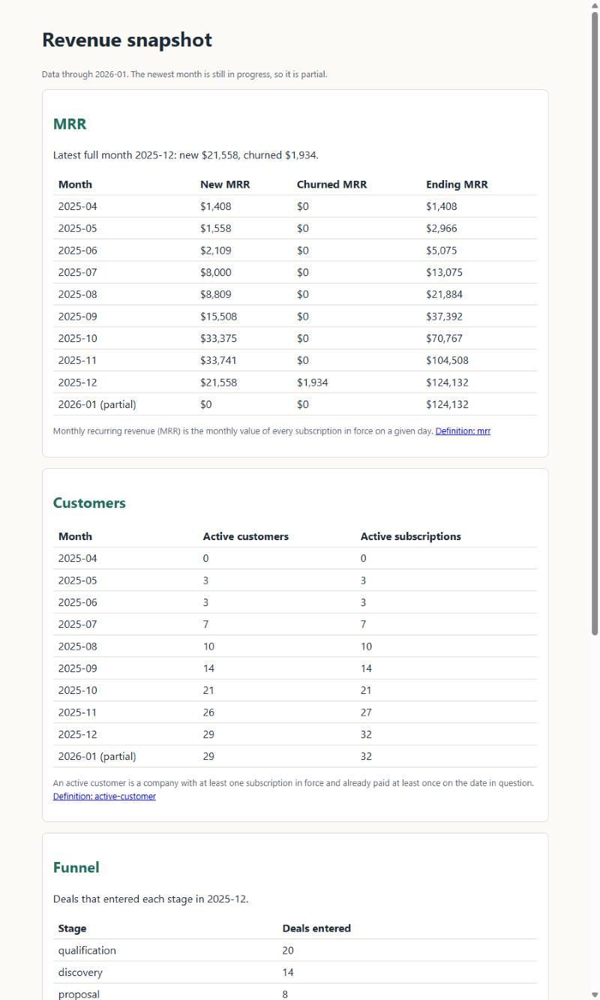
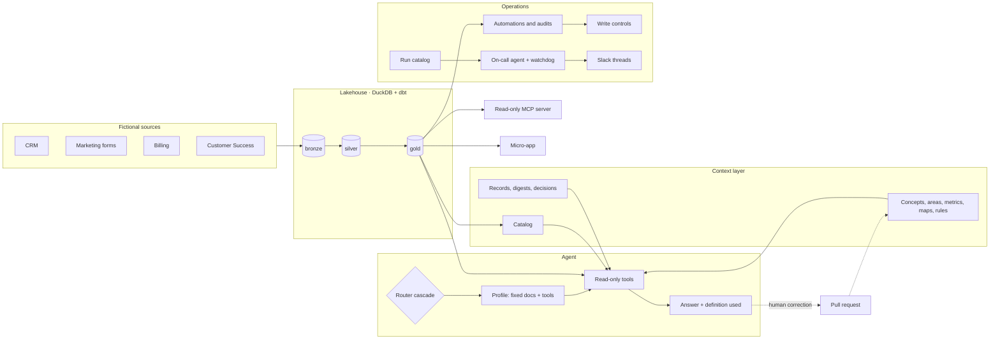

<div align="center">

# RevOps Agent

**An AI agent that answers revenue questions from a governed data and context layer, and a working example of how to build one so it can be trusted.**

Medallion lakehouse · context by area · intent routing · RAG with evals · read-only MCP · automations with write controls · run catalog and on-call agent

[](https://github.com/leoippolitos-svg/revops-agent/actions/workflows/ci.yml)
[](LICENSE)


[What this is](#what-this-is) · [Why](#why-it-exists) · [What it controls](#what-it-controls-and-what-it-cannot-touch) · [Worth](#what-it-is-worth-and-where-it-can-go) · [Reading guide](#reading-guide) · [See it](#see-it) · [Status](#what-is-built-and-what-is-not) · [How it works](#how-it-works) · [Structure](#project-structure) · [Run it](#run-it) · [Decisions](#design-decisions)

</div>

---

> [!NOTE]
> **Everything here is fictional.** The company (Fernway), its data, people and rules are invented. The architecture recreates a RevOps agent I designed and ran in production as a RevOps Lead; no real data, prompts, field names or schemas are included.

## What this is

A portfolio project by [Leonardo Ippolito](https://github.com/leoippolitos-svg), RevOps Lead moving into GTM and AI engineering. It rebuilds, in the open and on a fictional company, the system a revenue team needs before it lets an AI agent near its numbers:

1. a **data layer** the agent can query but never change,
2. a **context layer**, organised by company, area, metric, CRM map and rule, that says what every number means,
3. an **agent** that routes a question, loads the context that question always needs, retrieves the rest and states the definition it used,
4. **automations, audits and a micro-app** that reuse the same rules and write only under explicit controls,
5. **operations around it**: a catalog of everything that runs, job health, Slack alerts, an on-call agent and a watchdog,
6. **guardrails and a working process** (pull requests, records, session closing, verification) that keep all of it honest as it changes.

It is a reference design with real code and tests, not a product. The [status table](#what-is-built-and-what-is-not) says exactly what has and has not been run.

## Why it exists

Revenue teams rarely lack data. They lack **shared meaning**.

"MQL" in Marketing is not "MQL" in Sales, so two teams bring two numbers to the same meeting. An AI agent placed on top of that inherits the problem and guesses. The model is not the bottleneck; **context is**. In the original system, the biggest quality gains came from the context and the mechanisms around the model, not from the model.

So this project treats the agent as the last mile of a data and context system, not as a chatbot over a database. Most of the work, and most of the code, is everything around the model.

## What it controls, and what it cannot touch

The design rule is that **the agent advises and people execute.** Each row is something the system can do, the limit that holds it, and where to read it. The limits are enforced in code, CI and read-only connections, not in a prompt ([ADR-0005](docs/adr/0005-enforce-rules-outside-the-model.md)).

| What it does | What it can touch | The limit that holds | Read more |
|---|---|---|---|
| **Answers revenue questions** | `gold` tables and context, through 5 read-only tools | One parsed `SELECT`; `silver` and `bronze` refused; closed map keys; real total next to every sample ([ADR-0013](docs/adr/0013-query-gold-checks-the-parsed-query-and-the-connection.md), [ADR-0019](docs/adr/0019-a-fifth-read-only-tool-for-closed-maps.md)) | [`agent/`](agent) |
| **Defines every metric once** | 7 concepts and 27 documents by company, area, metric, CRM map, report and rule | A check fails the PR if a document misses a section of its kind or points at a column that does not exist | [`context/`](context), [`docs/catalog.md`](docs/catalog.md) |
| **Serves other tools** | Gold, the catalog and the documents, over MCP | Same guard as the agent; no SQL logic of its own ([ADR-0017](docs/adr/0017-mcp-server-speaks-json-rpc-by-hand.md)) | [`mcp_server/`](mcp_server) |
| **Routes new leads** | One field: the lead's owner (simulated) | Kill switch, cap per run, circuit breaker, read-back, "needs review" never "skipped"; rules from the context document | [`automations/lead-routing/`](automations/lead-routing/SPEC.md) |
| **Provisions a signed customer** | One workspace request per signed deal (simulated) | Same controls; held on a possible duplicate; no back-fill past 60 days | [`automations/closed-won-provisioning/`](automations/closed-won-provisioning/SPEC.md) |
| **Audits and reconciles weekly** | Reads gold, writes reports and alerts | Explicit-id joins; divergence, pending or known case; a proposal, never a correction ([audit standard](docs/standards/audits.md)) | [`automations/`](automations) |
| **Watches everything that runs** | Workflow runs, job health, Slack threads | One card per job; alerts built by code; the on-call agent may only open a PR or ask for a rerun of an idempotent job ([ADR-0021](docs/adr/0021-an-on-call-agent-between-two-steps-without-ai.md)) | [`catalog/`](catalog), [`oncall/`](oncall) |
| **Shows the numbers to leaders** | A read-only page over four gold tables | No form, no input, no script; labels the partial month | [`apps/revenue-snapshot/`](apps/revenue-snapshot/SPEC.md) |

**What it never does:** write to a data source from the agent, send a message written by a model, change a record outside the [write-back rules](context/rules/writeback-rules.md), read `silver` or `bronze` to answer a business question, or accept real company data into the repository. Every outside connection is in the [connector registry](connectors/registry.yaml) with its smallest scope; the CRM, billing, product, Slack and GitHub write paths are **simulated or switched off**.

## What it is worth, and where it can go

**The potential.** Each piece is one a revenue team usually has to build by hand and keep alive:

- **One meaning per metric, organised the way the business is.** Company, OKRs, who is who, each area's KPIs and anti-confusions, each metric's formula and source, the CRM map. A new hire, an agent and a dashboard read the same definition.
- **A rule changed in one place.** Automations read their thresholds, caps and waits from the context documents; changing a rule is a reviewed document change, not a code hunt.
- **Writes that cannot surprise anyone.** Every write has an authorization, a kill switch, a cap, a breaker and a check after writing.
- **Operations that look after themselves.** A catalog of everything that runs, health three times a day, one Slack thread per problem, an on-call agent that fixes what is code and gives a person the exact step for the rest.
- **A memory that is searched.** Records, project digests and decisions the agent treats as final.

**What a team should gain.** These are **intent, not measured results**: nothing here has run against a real team or a real model.

| Gain | Why the design should deliver it |
|---|---|
| Fewer arguments about whose number is right | One canonical definition per concept, team differences written down, area documents that point to them |
| Answers that load the right rule every time | Fixed documents per intent, so what an answer needs never depends on retrieval luck |
| Less time rebuilding the same report | Recurring questions become automations and audits with a spec |
| Safer automation | Dry run, kill switch, cap, breaker, read-back, review queue, and a check that only authorised jobs write |
| Problems found before someone asks | Job health, alerts, an on-call agent and a watchdog |
| Changes that stay explainable | A pull request, a record and a session digest for every change |

**Where it goes next**, needing credentials or a real environment: run `--ask` once and score the evals, switch on the Slack webhook, the on-call agent and the AI security review, connect a real MCP client, and host a web chat (deferred in [ADR-0022](docs/adr/0022-the-web-chat-app-waits-for-a-host-and-a-key.md)).

## Reading guide

Short on time? Read in this order.

| Time | Read | You will see |
|---|---|---|
| 2 min | This page, then the [status table](#what-is-built-and-what-is-not) | What exists and what was never run |
| 5 min | [`context/company/`](context/company), [`context/areas/area-sales.md`](context/areas/area-sales.md), [`context/metrics/metrics-sales.md`](context/metrics/metrics-sales.md) | How the business is written down: company, who is who, an area, its metrics |
| 5 min | [`agent/directives/AGENT.md`](agent/directives/AGENT.md) and [`routing.md`](agent/directives/routing.md) | The reading order, the rules it never breaks, intents and their profiles |
| 5 min | [`context/rules/writeback-rules.md`](context/rules/writeback-rules.md) and [`automations/lead-routing/SPEC.md`](automations/lead-routing/SPEC.md) | What may be written, by whom, under which controls |
| 5 min | [`automations/reconciliation/`](automations/reconciliation/SPEC.md) and [`docs/standards/audits.md`](docs/standards/audits.md) | An audit that proposes and never corrects |
| 5 min | [`catalog/`](catalog), [`docs/run-catalog.md`](docs/run-catalog.md), [`oncall/`](oncall) | Everything that runs, its health, and who reacts when it breaks |
| 5 min | [`analyses/2026-01-new-mrr-december/`](analyses/2026-01-new-mrr-december/result.md) | A finished analysis: question, query, data checks, definitions, limits |
| 5 min | [`docs/adr/`](docs/adr) | 22 short decisions, each with the reason and the alternative rejected |
| 10 min | [`docs/standards/`](docs/standards) and [`docs/lessons-learned.md`](docs/lessons-learned.md) | The rules the repo enforces on itself, and where they came from |

## See it

Nothing below needs an API key.

**1. The plan before any model is called.** The router picks an intent (and logs which step decided), the tools, the model tier, the fixed documents it will always read, and a call budget. The system prompt is four blocks, the two stable ones cached:

```text
$ python agent/agent.py --plan "How many MQLs did we get in September?"
{
  "intent": "metric_lookup", "via": "rules", "tier": "fast",
  "tools": ["search_context", "query_gold", "get_map"],
  "fixed_docs": ["company", "entities", "data-map"],
  "model": "claude-haiku-5-5", "budget": 3,
  "system_blocks": [{"chars": 10898, "cached": true}, {"chars": 10078, "cached": true},
                    {"chars": 73, "cached": false}, {"chars": 1878, "cached": false}]
}
```

**2. Retrieval, routing and profiles are scored, not assumed.**

```text
$ python evals/run_retrieval.py
50 cases: Hit@3 1.000 (target 0.9), MRR 0.893 (target 0.75)
$ python evals/run_router.py
router_cases.yaml: 40 cases, accuracy 1.000 (target 0.9)
router_heldout.yaml: 27 cases, accuracy 1.000 (target 0.9)
$ python evals/run_profiles.py
profile_cases.yaml: 12 cases, pass rate 1.000 (target 1.0)
```

The sets are self-written and no model is called, so the scores show the deterministic parts work, not that answers are good. Each eval says so in its header.

**3. An audit that finds a real case in the fictional data.**

```text
$ python automations/reconciliation/reconcile.py
## Divergence (1)
| 36 | won without subscription | Finance, with Customer Success for the kickoff | start the subscription for deal 36, or reopen the deal |
## Pending (2)   ...   ## Known case (1)   ...
This is a proposal. Nothing was corrected.
```

**4. A read-only page over the gold layer**, each block with its definition:

<div align="center">



</div>

## What is built and what is not

> [!IMPORTANT]
> Everything in this repository is built and tested, and **nothing has run against a real model or client.** The model adapter was tested against a fake API and has never used a key. Answer quality, the with-context versus without-context comparison and the skill triggers are **not measured**, because they need a real model. Every write to an outside system is simulated or behind a switch that is off.

| Piece | Built and tested | Run for real |
|---|---|---|
| Data pipeline: generator, bronze → silver → gold with dbt | Yes, 11 gold models with tests | Yes, end to end on fictional data |
| Context layer: 7 concepts and 27 documents by kind, catalog, checks | Yes | Yes |
| Retrieval by category, incremental reingest, 50 retrieval, 67 router and 12 profile cases | Yes | Yes, scored above |
| Five agent tools, router cascade, category profiles, four-block prompt, cost per answer | Yes, with a scripted model | No model call; prices left empty, so cost is logged as null |
| Model adapter (Claude Messages API, standard library, cache markers) | Yes, against a fake API | No, never used a key |
| Read-only MCP server (JSON-RPC over stdio) | Yes, against hand-made messages | No real MCP client |
| Revenue-snapshot micro-app, app template and playbook | Yes | Page rendered from the local lakehouse |
| Automations: lead routing, provisioning (with write controls), weekly audit, reconciliation, duplicate queue, funnel review | Yes | The three weekly reads are scheduled; writes are simulated log lines |
| Run catalog, job health, Slack alerts (simulated) | Yes | The collector is scheduled; Slack has never been posted to |
| On-call agent and watchdog | Yes; the steps without AI are tested | Workflows exist; every switch is off and the agent step has never run |
| Verification: reviewer agents, profile eval, personal-data guard, AI security review | Yes | The AI review is off until a key exists |
| With vs without context comparison | Design and 18 questions | No, needs a model |

Open owner questions, such as the funnel-review thresholds, are in [`memory/decisions/`](memory/decisions) and [`BACKLOG.md`](BACKLOG.md), not buried in code.

## How it works

| | Layer | What it does |
|---|---|---|
| 1 | **Data** | Raw sources land in a medallion lakehouse: `bronze` (raw mirror) → `silver` (clean, typed) → `gold` (business metrics and record-level audit lists) |
| 2 | **Meaning** | A *catalog* describes every table and column. *Context documents* define every concept and describe the company, each area, its metrics, the CRM, reports and rules |
| 3 | **Agent** | Routes each question (model, rules, default), loads the intent's fixed documents, retrieves the rest as reference, queries `gold` read-only and answers in business language with the definition used |
| 4 | **Writes** | Only deterministic automations write, only fields on the write-back list, each behind a kill switch, a cap, a breaker and a read-back |
| 5 | **Operations** | A card per job, health three times a day, Slack threads built by code, an on-call agent and a watchdog |
| 6 | **Memory and process** | Records per PR, project digests per session, decisions the agent treats as final; session closing and verification before "done" |

### Highlights

- 🧱 **Medallion lakehouse** on DuckDB + dbt, refreshed with simulated business days
- 📖 **Context by area**: company, OKRs, entities, seven areas, metrics per area, CRM and data maps, reports, rules, each with a required shape checked in CI
- 🧭 **Router cascade and category profiles**: the documents an answer needs are loaded by id, never left to retrieval luck
- 🧩 **Four-block prompt with cache**: rules and category documents cached, today's date and retrieved context after the last marker
- 🔎 **RAG with evals**: five categories, incremental reingest by hash, retrieval, router and profile evals
- 🛡️ **Write controls**: kill switch, cap per run, circuit breaker, read-back, review queue, and a check that only authorised jobs write
- 🧾 **Audits that propose**: explicit-id reconciliation with divergence, pending and known case, and a duplicate queue that never merges
- 🚨 **Run catalog, Slack alerts, on-call agent, watchdog**, all with switches off until enabled
- 🔁 **Correction loop and session closing**: a corrected answer becomes a pull request; every session leaves a digest
- 🔒 **Rule zero enforced**: pre-commit and CI block secrets, real company terms and personal data

## Architecture



The dotted line is the step most teams skip: corrections flow back into the context layer, so the agent does not repeat the same mistake. Full description in [docs/architecture.md](docs/architecture.md); every table and column is in the [data catalog](docs/catalog.md).

## Project structure

```
revops-agent/
├── generator/        # Fictional company data, with deliberate data-quality issues
├── pipeline/         # Ingestion, dbt models (bronze → silver → gold), freshness checks
├── context/          # What the business means, checked in CI
│   ├── concepts/     # One business concept each (MQL, MRR, funnel stages...)
│   ├── company/      # Company, OKRs, teams and people
│   ├── areas/        # One document per area
│   ├── metrics/      # Formulas and sources per area
│   ├── crm/          # CRM map and data map, with model queries
│   ├── reports/      # How each report number is computed; benchmarks
│   └── rules/        # Write-back rules, agent security, ICP, apps, session closing
├── agent/
│   ├── directives/   # AGENT.md (reading order, rules), routing.md (intents, profiles), fallback.md
│   ├── skills/       # 13 business skills and the question-to-skill map
│   ├── rag/          # Corpus by category, retrieval, incremental ingest
│   └── tools/        # Five read-only tools
├── mcp_server/       # Read-only MCP server over gold
├── automations/      # Six automations and audits, plus the shared write controls
├── catalog/          # One card per thing that runs
├── oncall/           # On-call agent prompt, executor and watchdog
├── observability/    # Agent log with cost, job health, Slack notifier
├── apps/             # Micro-apps and their template, spec-first
├── analyses/         # Analyses as code: query, result, definitions used
├── evals/            # Retrieval, routing, profile, skill-trigger and context A/B sets
├── projects/         # Work that spans sessions, with digests
├── memory/           # Decisions the agent treats as final, patterns, baselines
├── records/          # One record per merged pull request
├── connectors/       # Registry of every external connection
├── design-system/    # Design tokens used by the micro-apps
├── destinations/     # Simulated reverse ETL
├── tests/            # 521 tests covering every piece above
├── docs/
│   ├── standards/    # The rules: context, modeling, security, apps, audits, verification, process...
│   ├── adr/          # Architecture decision records
│   └── lessons-learned.md
├── tools/            # Repo checks, catalog collector, leak and personal-data guards, git hooks
├── WORKSPACE.md      # Where work lives, and the project index
├── BACKLOG.md        # Pending items that must not get lost
└── .claude/          # Coding-agent skills and reviewer agents
```

Two kinds of skills live here on purpose: `.claude/skills/` teach the **coding agent** how to build the repo, `agent/skills/` teach the **RevOps agent** how to do business work.

## Run it

**Requirements:** Python 3.12, Git.

```bash
git clone https://github.com/leoippolitos-svg/revops-agent.git
cd revops-agent
pip install -r requirements.txt
git config core.hooksPath tools/hooks   # run the repo checks before every commit
```

Build the whole local lakehouse with one command, no cloud accounts. It generates fictional data, loads it into bronze, builds silver and gold with dbt, and runs the checks. The result is `data/lakehouse.duckdb`.

```bash
python tools/setup.py   # or: make setup
```

Then try each piece. None of these calls a model.

| To see | Run |
|---|---|
| The whole test suite | `python -m pytest` |
| Every repo check | `make check`, or run the scripts in `tools/` one by one |
| How the agent would handle a question | `python agent/agent.py --plan "your question"` |
| A closed map (owners, stages, teams, job health) | `python agent/tools/get_map.py owners` |
| The evals | `python evals/run_retrieval.py`, `run_router.py`, `run_profiles.py` |
| The revenue page | `python apps/revenue-snapshot/snapshot.py --out snapshot.html` |
| The weekly audits (dry run) | `python automations/audits/audit.py`, `automations/reconciliation/reconcile.py`, `automations/duplicate-companies/duplicates.py` |
| What runs and its health | `python tools/catalog.py check` and `python tools/catalog.py collect` |
| The MCP server | `python mcp_server/server.py` (speaks JSON-RPC on stdin and stdout) |

Every automation is a **dry run unless you pass `--write`**, and a writing automation also needs its kill switch (`<NAME>_ENABLED=true`); in this repository its only effect is a log line.

To ask the agent a real question you need your own key, kept in an environment variable and never in the repo:

```bash
export ANTHROPIC_API_KEY=...   # your own key
python agent/agent.py --ask "What was the ending MRR last month?"
```

This path is built but has never been run; see the [status table](#what-is-built-and-what-is-not).

## Roadmap

- [x] **Phase 0** · Skeleton, standards, guardrails, CI
- [x] **Phase 1** · Data generator and bronze → silver → gold
- [x] **Phase 2** · Context documents and catalog checks
- [x] **Phase 3** · Agent: tools, model tiers, retrieval, router, loop, model adapter and evals
- [x] **Phase 4** · Skills, connector registry and the MCP server
- [x] **Phase 5** · With-context vs without-context comparison (design, 18 questions; no run made)
- [x] **Phase 6** · Micro-app and automations built from their specs
- [x] **Phase 7** · Parity with the original agent: context by area, prompt blocks and profiles, map tool, cost, write controls, run catalog, Slack, on-call, verification, audits, retrieval by category, skills and process

**Next, and needing a real model or a host:** run `--ask` once, score the context A/B, skill triggers and answer quality, switch on Slack and the on-call agent, and host the web chat.

## Design decisions

Each decision is a short record with the context, the choice and the alternative rejected.

| ADR | Decision |
|---|---|
| [0001](docs/adr/0001-duckdb-as-lakehouse.md) | DuckDB as the lakehouse, vectors included |
| [0002](docs/adr/0002-dbt-for-transformations.md) | dbt for transformations; schema descriptions are the catalog |
| [0003](docs/adr/0003-catalog-separate-from-context.md) | Catalog separate from context documents |
| [0004](docs/adr/0004-pull-request-for-every-unit-of-work.md) | A pull request for every unit of work |
| [0005](docs/adr/0005-enforce-rules-outside-the-model.md) | Enforce rules outside the model |
| [0006](docs/adr/0006-four-agent-tools-and-two-model-tiers.md) | Four agent tools and two model tiers |
| [0007](docs/adr/0007-lexical-retrieval-first.md) | Lexical retrieval first, vectors only if measured |
| [0008](docs/adr/0008-mcp-server-exposes-gold-read-only.md) | The MCP server exposes gold, read-only |
| [0009](docs/adr/0009-scheduled-work-is-an-automation.md) | Scheduled work is an automation, not a skill |
| [0010](docs/adr/0010-lead-routing-may-set-the-owner-field.md) | Lead routing may set one field, the owner |
| [0011](docs/adr/0011-provisioning-may-create-one-workspace.md) | Provisioning may create one workspace per signed deal |
| [0012](docs/adr/0012-bm25-in-plain-python-for-now.md) | BM25 in plain Python for now |
| [0013](docs/adr/0013-query-gold-checks-the-parsed-query-and-the-connection.md) | `query_gold` checks the parsed query and the connection |
| [0014](docs/adr/0014-router-starts-as-rules.md) | The router starts as rules, not a model |
| [0015](docs/adr/0015-agent-loop-is-model-agnostic.md) | The agent loop does not depend on a model provider |
| [0016](docs/adr/0016-model-adapter-uses-the-standard-library.md) | The model adapter is built by hand on the standard library, and never run here |
| [0017](docs/adr/0017-mcp-server-speaks-json-rpc-by-hand.md) | The MCP server speaks the protocol by hand and delegates every guard |
| [0018](docs/adr/0018-system-prompt-in-four-blocks-with-category-profiles.md) | The system prompt is four ordered blocks, and each intent has a profile |
| [0019](docs/adr/0019-a-fifth-read-only-tool-for-closed-maps.md) | A fifth read-only tool, `get_map`, for closed maps |
| [0020](docs/adr/0020-slack-alerts-built-by-code-and-simulated.md) | Slack alerts are built by code, one thread per item, simulated until a webhook exists |
| [0021](docs/adr/0021-an-on-call-agent-between-two-steps-without-ai.md) | An on-call agent between two steps without AI, and a watchdog |
| [0022](docs/adr/0022-the-web-chat-app-waits-for-a-host-and-a-key.md) | The web chat app waits for a host and a key |

Standards live in [docs/standards/](docs/standards/).

## Tech stack

| Area | Choice |
|---|---|
| Language | Python 3.12 |
| Storage and vectors | DuckDB (+ `vss`) |
| Transformations | dbt-core + dbt-duckdb |
| Retrieval | BM25 in plain Python, corpus by category |
| LLM | Claude API, through a standard-library adapter with prompt caching |
| Tool protocol | MCP (JSON-RPC 2.0 over stdio) |
| Scheduling | GitHub Actions |
| Tests | pytest |
| CI | GitHub Actions, gitleaks, leak and personal-data guards |

## Contributing

This is a personal portfolio project and does not accept pull requests. Feedback is welcome through [issues](https://github.com/leoippolitos-svg/revops-agent/issues). See [CONTRIBUTING.md](CONTRIBUTING.md).

## License

[MIT](LICENSE) © 2026 Leonardo Ippolito

<div align="center">

**Built by Leonardo Ippolito** · RevOps Lead → GTM & AI Engineering

</div>
