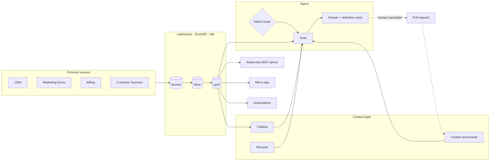

<div align="center">

# RevOps Agent

**An AI agent that answers revenue questions from a governed data and context layer, and a working example of how to build one so it can be trusted.**

Medallion lakehouse · context documents · intent routing · RAG with evals · read-only MCP · automations

[](https://github.com/leoippolitos-svg/revops-agent/actions/workflows/ci.yml)
[](LICENSE)


[What this is](#what-this-is) · [Why](#why-it-exists) · [Reading guide](#reading-guide) · [See it](#see-it) · [Status](#what-is-built-and-what-is-not) · [How it works](#how-it-works) · [Structure](#project-structure) · [Run it](#run-it) · [Decisions](#design-decisions)

</div>

---

> [!NOTE]
> **Everything here is fictional.** The company (Fernway), its data, people and rules are invented. The architecture reflects patterns I designed and ran in production as a RevOps Lead; no real data, prompts or schemas are included.

## What this is

A portfolio project by [Leonardo Ippolito](https://github.com/leoippolitos-svg), RevOps Lead moving into GTM and AI engineering. It builds, end to end and in the open, the system I think a revenue team needs before it lets an AI agent near its numbers:

1. a **data layer** the agent can query but never change,
2. a **context layer** that says what every metric means,
3. an **agent** that routes a question, loads only the context it needs and states the definition it used,
4. **automations** and a **micro-app** that reuse the same rules,
5. **guardrails and a working process** that keep all of it honest as it changes.

It is a reference design with real code and tests, not a product. The [next section](#what-is-built-and-what-is-not) says exactly what has and has not been run.

## Why it exists

Revenue teams rarely lack data. They lack **shared meaning**.

"MQL" in Marketing is not "MQL" in Sales, so two teams bring two numbers to the same meeting. An AI agent placed on top of that inherits the problem and guesses. The model is not the bottleneck; **context is**.

So this project treats the agent as the last mile of a data and context system, not as a chatbot over a database. Most of the work, and most of the code, is everything around the model.

## Reading guide

Short on time? Read in this order.

| Time | Read | You will see |
|---|---|---|
| 2 min | This page, then the [Status](#what-is-built-and-what-is-not) table | What exists and what was never run |
| 5 min | [`context/concepts/mql.md`](context/concepts/mql.md) and [`lead-routing.md`](context/concepts/lead-routing.md) | How a business rule is written once, with its gotchas and team differences |
| 5 min | [`agent/directives/`](agent/directives) and [`agent/README.md`](agent/README.md) | The agent's protocol, its router and its four read-only tools |
| 5 min | [`automations/lead-routing/SPEC.md`](automations/lead-routing/SPEC.md) | A spec-first automation: trigger, effects, failure behavior, "must never", dry run |
| 5 min | [`docs/adr/`](docs/adr) | 17 short decisions, each with the reason and the alternative rejected |
| 5 min | [`records/`](records) | One record per merged pull request: the project's operational memory |
| 10 min | [`docs/standards/`](docs/standards) | The rules the repo enforces on itself |

## See it

Nothing below needs an API key.

**1. The router decides before any model is called.** It picks an intent, the tools, the model tier, the skill and a call budget:

```text
$ python agent/agent.py --plan "What was MRR last month?"
{
  "intent": "metric_lookup",
  "tools": ["search_context", "query_gold"],
  "tier": "fast",
  "skill": null,
  "model": "claude-haiku-5-5",
  "budget": 3
}
```

**2. Retrieval and routing are scored, not assumed.**

```text
$ python evals/run_retrieval.py
50 cases: Hit@3 1.000 (target 0.9), MRR 0.913 (target 0.75)
$ python evals/run_router.py
router_cases.yaml: 40 cases, accuracy 1.000 (target 0.9)
router_heldout.yaml: 27 cases, accuracy 1.000 (target 0.9)
```

These sets are self-written, so the scores show the pipeline works, not that it generalises. That limit is stated in the repo, not hidden.

**3. A read-only page over the gold layer.** Each block shows its definition and links to the context document behind it; the month in progress is labelled partial:

<div align="center">


</div>

```bash
python apps/revenue-snapshot/snapshot.py --out snapshot.html
```

## What is built and what is not

> [!IMPORTANT]
> Everything in this repository is built and tested, and **nothing has run against a real model or client.** The model adapter was tested against a fake API and has never used a key. Answer quality, the with-context versus without-context comparison and the skill triggers are **not measured**, because they need a real model.

| Piece | Built and tested | Run for real |
|---|---|---|
| Data pipeline: generator, bronze → silver → gold with dbt | Yes, 8 gold models with tests | Yes, end to end on fictional data |
| Context layer: 7 documents, catalog, consistency checks | Yes | Yes |
| Retrieval (BM25 in plain Python) and 90 eval cases | Yes | Yes, scored above |
| Four agent tools, intent router, agent loop | Yes, with a scripted model | No model call |
| Model adapter (Claude Messages API, standard library) | Yes, against a fake API | No, never used a key |
| Read-only MCP server (JSON-RPC over stdio) | Yes, against hand-made messages | No real MCP client |
| Revenue-snapshot micro-app | Yes | Yes, rendered from the local lakehouse |
| Automations: lead routing, closed-won provisioning, weekly audit, funnel review | Yes, dry run by default; writes are simulated log lines | No CRM or product; only the audit is scheduled |
| With vs without context comparison | Design and 18 questions | No, needs a model |

Open items the owner still has to confirm, such as the funnel-review thresholds, are listed in [`records/`](records) rather than buried in code.

## How it works

| | Layer | What it does |
|---|---|---|
| 1 | **Data** | Raw sources land in a medallion lakehouse: `bronze` (raw mirror) → `silver` (clean, typed) → `gold` (business metrics) |
| 2 | **Meaning** | A *catalog* describes every table and column. *Context documents* define every business concept, one per document, linked to the catalog |
| 3 | **Agent** | Routes each question to an intent, retrieves only the context it needs, queries `gold` read-only, and states the definition it used |
| 4 | **Memory** | Every unit of work (analysis, automation, rule change) lands as a pull request with a record the agent can search later |
| 5 | **Guardrails** | Critical rules are enforced outside the model: read-only connections, parsed-query checks, denied commands, CI checks |

### Highlights

- 🧱 **Medallion lakehouse** on DuckDB + dbt, refreshed on a schedule with simulated business days
- 📖 **Context layer** separating the catalog (what the data *is*) from context documents (what the business *means*)
- 🧭 **Intent router** with model tiers and a call budget, plus explicit fallback behavior for ambiguity and missing context
- 🔎 **RAG with evals**: transactional reingest, 50 retrieval cases scored by Hit@K and MRR, plus a held-out router set
- 🔌 **Read-only MCP server** exposing the gold layer, the catalog and the context documents
- 🤖 **Automations that read their rules from the context documents**, so changing a rule changes the behavior with no code change
- 🧪 **With vs without context**: 18 questions designed to be answered both ways (not yet run)
- 🔁 **Correction loop**: a corrected answer becomes a pull request to the context layer
- 🛡️ **Rule zero enforced**: pre-commit and CI block secrets and real company terms

## Architecture



The dotted line is the step most teams skip: corrections flow back into the context layer, so the agent does not repeat the same mistake. Full description in [docs/architecture.md](docs/architecture.md); every table and column is in the [data catalog](docs/catalog.md).

## Project structure

```
revops-agent/
├── generator/        # Fictional company data, with deliberate data-quality issues
├── pipeline/         # Ingestion, dbt models (bronze → silver → gold), freshness checks
├── context/          # Context documents, one business concept each, and their index
├── agent/
│   ├── directives/   # AGENT.md, routing.md, fallback.md
│   ├── skills/       # Business skills: funnel-diagnosis, trend-analysis, data-discrepancy, html-report
│   ├── rag/          # Retrieval over context documents and records
│   └── tools/        # The four read-only tools
├── mcp_server/       # Read-only MCP server over gold
├── evals/            # Retrieval, routing, skill-trigger and context A/B sets
├── records/          # One record per merged pull request (operational memory)
├── analyses/         # Analyses as code: query, result, definitions used
├── automations/      # Lead routing, provisioning, weekly audit, funnel review
├── apps/             # Micro-apps, spec-first, under a security checklist
├── design-system/    # Design tokens used by the micro-apps
├── connectors/       # Registry of every external connection, live or simulated
├── destinations/     # Simulated reverse ETL
├── observability/    # Cost, latency and tool calls per question
├── tests/            # 435 tests covering every piece above
├── docs/
│   ├── standards/    # The rules: context docs, modeling, skills, PRs, security, RAG
│   └── adr/          # Architecture decision records
├── tools/            # Repo checks: skills standard, leak guard, git hooks
└── .claude/          # Coding-agent skills and guardrails
```

Two kinds of skills live here on purpose: `.claude/skills/` teach the **coding agent** how to build the repo, `agent/skills/` teach the **RevOps agent** how to do business work.

## Run it

**Requirements:** Python 3.12, Git.

```bash
git clone https://github.com/leoippolitos-svg/revops-agent.git
cd revops-agent
pip install -r requirements.txt
git config core.hooksPath tools/hooks   # run the repo checks before every commit
```

Build the whole local lakehouse with one command, no cloud accounts. It generates fictional data, loads it into bronze, builds silver and gold with dbt, and runs the checks. The result is `data/lakehouse.duckdb`.

```bash
python tools/setup.py   # or: make setup
```

Then try each piece. None of these calls a model.

| To see | Run |
|---|---|
| The whole test suite | `python -m pytest` |
| Every repo check | `make check`, or run the scripts in `tools/` one by one |
| How the agent would route a question | `python agent/agent.py --plan "your question"` |
| Retrieval and router scores | `python evals/run_retrieval.py` and `python evals/run_router.py` |
| The revenue page | `python apps/revenue-snapshot/snapshot.py --out snapshot.html` |
| The weekly data audit (dry run) | `python automations/audits/audit.py` |
| The MCP server | `python mcp_server/server.py` (speaks JSON-RPC on stdin and stdout) |

Every automation is a **dry run unless you pass `--write`**, and in this repository its only effect is a log line.

To ask the agent a real question you need your own key, kept in an environment variable and never in the repo:

```bash
export ANTHROPIC_API_KEY=...   # your own key
python agent/agent.py --ask "What was MRR last month?"
```

This path is built but has never been run; see [Status](#what-is-built-and-what-is-not).

## Roadmap

- [x] **Phase 0** · Skeleton, standards, guardrails, CI
- [x] **Phase 1** · Data generator and bronze → silver → gold
- [x] **Phase 2** · Context documents and catalog checks
- [x] **Phase 3** · Agent: tool contracts, model tiers, retrieval, router, loop, model adapter and 90 eval cases
- [x] **Phase 4** · Skills, connector registry check and the MCP server
- [x] **Phase 5** · With-context vs without-context comparison (design, 18 questions and a results file; no run made)
- [x] **Phase 6** · Micro-app under the security standard, and four automations built from their specs

**Next, and needing a real model:** run `--ask` once, then the first scored evals (context A/B, skill triggers, answer quality), and connect a real MCP client.

## Design decisions

Each decision is a short record with the context, the choice and the alternative rejected.

| ADR | Decision |
|---|---|
| [0001](docs/adr/0001-duckdb-as-lakehouse.md) | DuckDB as the lakehouse, vectors included |
| [0002](docs/adr/0002-dbt-for-transformations.md) | dbt for transformations; schema descriptions are the catalog |
| [0003](docs/adr/0003-catalog-separate-from-context.md) | Catalog separate from context documents |
| [0004](docs/adr/0004-pull-request-for-every-unit-of-work.md) | A pull request for every unit of work |
| [0005](docs/adr/0005-enforce-rules-outside-the-model.md) | Enforce rules outside the model |
| [0006](docs/adr/0006-four-agent-tools-and-two-model-tiers.md) | Four agent tools and two model tiers |
| [0007](docs/adr/0007-lexical-retrieval-first.md) | Lexical retrieval first, vectors only if measured |
| [0008](docs/adr/0008-mcp-server-exposes-gold-read-only.md) | The MCP server exposes gold, read-only |
| [0009](docs/adr/0009-scheduled-work-is-an-automation.md) | Scheduled work is an automation, not a skill |
| [0010](docs/adr/0010-lead-routing-may-set-the-owner-field.md) | Lead routing may set one field, the owner |
| [0011](docs/adr/0011-provisioning-may-create-one-workspace.md) | Provisioning may create one workspace per signed deal |
| [0012](docs/adr/0012-bm25-in-plain-python-for-now.md) | BM25 in plain Python for now |
| [0013](docs/adr/0013-query-gold-checks-the-parsed-query-and-the-connection.md) | `query_gold` checks the parsed query and the connection |
| [0014](docs/adr/0014-router-starts-as-rules.md) | The router starts as rules, not a model |
| [0015](docs/adr/0015-agent-loop-is-model-agnostic.md) | The agent loop does not depend on a model provider |
| [0016](docs/adr/0016-model-adapter-uses-the-standard-library.md) | The model adapter is built by hand on the standard library, and never run here |
| [0017](docs/adr/0017-mcp-server-speaks-json-rpc-by-hand.md) | The MCP server speaks the protocol by hand and delegates every guard |

Standards live in [docs/standards/](docs/standards/).

## Tech stack

| Area | Choice |
|---|---|
| Language | Python 3.12 |
| Storage and vectors | DuckDB (+ `vss`) |
| Transformations | dbt-core + dbt-duckdb |
| Retrieval | BM25 in plain Python |
| LLM | Claude API, through a standard-library adapter |
| Tool protocol | MCP (JSON-RPC 2.0 over stdio) |
| Tests | pytest |
| CI | GitHub Actions, gitleaks |

## Credits

Ideas, not code, came from:

- Anthropic: [Effective context engineering for AI agents](https://www.anthropic.com/research/effective-context-engineering-for-ai-agents) and *The Complete Guide to Building Skills for Claude*
- [Nekt Academy](https://academy.nekt.com/): context documents, catalog organization, the medallion lakehouse
- Winning by Design: the Bowtie model of the customer journey
- Tech Leads Club: [harness-toolkit](https://github.com/tech-leads-club/harness-toolkit) and [the-judge](https://agent-skills.techleads.club/skills/the-judge)
- Scient: GTM Engineering course

## Contributing

This is a personal portfolio project and does not accept pull requests. Feedback is welcome through [issues](https://github.com/leoippolitos-svg/revops-agent/issues). See [CONTRIBUTING.md](CONTRIBUTING.md).

## License

[MIT](LICENSE) © 2026 Leonardo Ippolito

<div align="center">

**Built by Leonardo Ippolito** · RevOps Lead → GTM & AI Engineering

</div>
