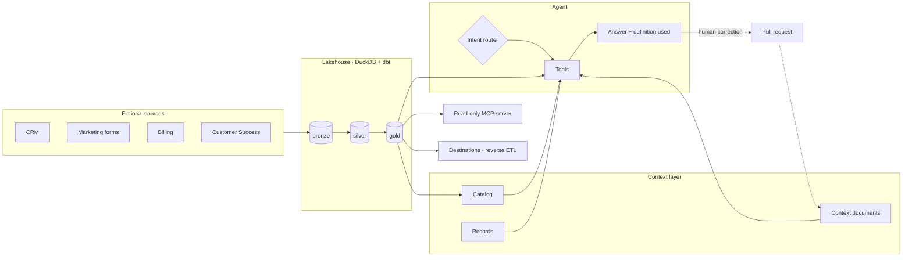

<div align="center">

# RevOps Agent

**An AI agent that answers revenue questions from a governed data and context layer.**

Medallion lakehouse · context documents · intent routing · RAG with evals · read-only MCP

[](https://github.com/leoippolitos-svg/revops-agent/actions/workflows/ci.yml)
[](LICENSE)


[Why](#why) · [How it works](#how-it-works) · [Architecture](#architecture) · [Project structure](#project-structure) · [Quick start](#quick-start) · [Roadmap](#roadmap) · [Decisions](#design-decisions)

</div>

---

> [!NOTE]
> **Everything here is fictional.** The company (Fernway), its data, people and rules are invented. The architecture reflects patterns I designed and ran in production as a RevOps Lead; no real data, prompts or schemas are included.

## Why

Revenue teams rarely lack data. They lack **shared meaning**.

"MQL" in Marketing is not "MQL" in Sales, so two teams bring two numbers to the same meeting. An AI agent placed on top of that inherits the problem and guesses. The model is not the bottleneck; **context is**.

This project treats the agent as the last mile of a data and context system, not as a chatbot over a database.

## How it works

| | Layer | What it does |
|---|---|---|
| 1 | **Data** | Raw sources land in a medallion lakehouse: `bronze` (raw mirror) → `silver` (clean, typed) → `gold` (business metrics) |
| 2 | **Meaning** | A *catalog* describes every table and column. *Context documents* define every business concept, one per document, linked to the catalog |
| 3 | **Agent** | Routes each question to an intent, retrieves only the context it needs, queries `gold` read-only, and states the definition it used |
| 4 | **Memory** | Every unit of work (analysis, automation, rule change) lands as a pull request with a record the agent can search later |
| 5 | **Guardrails** | Critical rules are enforced outside the model: read-only connections, denied commands, CI checks |

### Highlights

- 🧱 **Medallion lakehouse** on DuckDB + dbt, refreshed on a schedule with simulated business days
- 📖 **Context layer** separating the catalog (what the data *is*) from context documents (what the business *means*)
- 🧭 **Intent router** with model tiers, plus explicit fallback behavior for ambiguity and missing context
- 🔎 **RAG with evals**: transactional reingest, ~40-question test set, Hit@K and MRR
- 🔌 **Read-only MCP server** exposing the gold layer and catalog
- 🧪 **With vs without context**: the same questions answered both ways, side by side
- 🔁 **Correction loop**: a corrected answer becomes a pull request to the context layer
- 🛡️ **Rule zero enforced**: pre-commit and CI block secrets and real company terms

## Architecture



The dotted line is the step most teams skip: corrections flow back into the context layer, so the agent does not repeat the same mistake. Full description in [docs/architecture.md](docs/architecture.md); every table and column is in the [data catalog](docs/catalog.md).

## Project structure

```
revops-agent/
├── generator/        # Fictional company data, with deliberate data-quality issues
├── pipeline/         # Ingestion, dbt models (bronze → silver → gold), freshness checks
├── context/          # Context documents, one business concept each, and their index
├── agent/
│   ├── directives/   # AGENT.md, routing.md, fallback.md
│   └── skills/       # Business skills: funnel-diagnosis, trend-analysis, data-discrepancy, html-report
├── mcp_server/       # Read-only MCP server over gold
├── evals/            # Retrieval, routing and skill-trigger test sets
├── records/          # One record per merged pull request (operational memory)
├── analyses/         # Analyses as code: query, result, definitions used
├── automations/      # Lead routing, provisioning, weekly audits
├── apps/             # Micro-apps, spec-first, under a security checklist
├── connectors/       # Registry of every external connection, live or simulated
├── destinations/     # Simulated reverse ETL
├── observability/    # Cost, latency and tool calls per question
├── docs/
│   ├── standards/    # The rules: context docs, modeling, skills, PRs, security, RAG
│   └── adr/          # Architecture decision records
├── tools/            # Repo checks: skills standard, leak guard, git hooks
└── .claude/          # Coding-agent skills and guardrails
```

Two kinds of skills live here on purpose: `.claude/skills/` teach the **coding agent** how to build the repo, `agent/skills/` teach the **RevOps agent** how to do business work.

## Quick start

> [!IMPORTANT]
> The data pipeline works end to end (Phase 1). Phases 3 to 6 are written as rules, specs and eval cases. Retrieval over the context documents is built and scored (`python evals/run_retrieval.py`); the agent, the MCP server and the micro-app are not built yet.

**Requirements:** Python 3.12, Git.

```bash
git clone https://github.com/leoippolitos-svg/revops-agent.git
cd revops-agent
pip install -r requirements.txt

python tools/check_skills.py   # validates every skill against the standard
python tools/check_leaks.py    # blocks real company terms (needs .leak-terms)
python tools/check_context.py  # context documents and the dbt catalog must agree
python tools/build_catalog.py  # rewrites docs/catalog.md from the dbt descriptions

git config core.hooksPath tools/hooks   # run both checks before every commit
```

Build the whole local lakehouse with one command, no cloud accounts:

```bash
python tools/setup.py   # or: make setup
```

It generates fictional data, loads it into bronze, builds silver and gold with dbt, and runs the checks. The result is `data/lakehouse.duckdb`.

## Roadmap

- [x] **Phase 0** · Skeleton, standards, guardrails, CI
- [x] **Phase 1** · Data generator and bronze → silver → gold
- [x] **Phase 2** · First five context documents and catalog checks
- [x] **Phase 3** · Agent rules: tool contracts, model tiers, retrieval approach and 90 eval cases (retrieval is built and scored; the agent loop and the other tools are not built)
- [x] **Phase 4** · Skills (7 new), connector registry check and MCP server contract (rules only; the MCP server code is not built)
- [x] **Phase 5** · With-context vs without-context comparison (design, 18 questions and a results file; no run made)
- [x] **Phase 6** · Example micro-app under the security standard (spec, design tokens and a spec checker; the app is not built)

## Design decisions

| ADR | Decision |
|---|---|
| [0001](docs/adr/0001-duckdb-as-lakehouse.md) | DuckDB as the lakehouse, vectors included |
| [0002](docs/adr/0002-dbt-for-transformations.md) | dbt for transformations; schema descriptions are the catalog |
| [0003](docs/adr/0003-catalog-separate-from-context.md) | Catalog separate from context documents |
| [0004](docs/adr/0004-pull-request-for-every-unit-of-work.md) | A pull request for every unit of work |
| [0005](docs/adr/0005-enforce-rules-outside-the-model.md) | Enforce rules outside the model |

Standards live in [docs/standards/](docs/standards/).

## Tech stack

| Area | Choice |
|---|---|
| Language | Python 3.12 |
| Storage and vectors | DuckDB (+ `vss`) |
| Transformations | dbt-core + dbt-duckdb |
| LLM | Claude API |
| Tool protocol | MCP |
| CI | GitHub Actions, gitleaks |

## Credits

Ideas, not code, came from:

- Anthropic: [Effective context engineering for AI agents](https://www.anthropic.com/research/effective-context-engineering-for-ai-agents) and *The Complete Guide to Building Skills for Claude*
- [Nekt Academy](https://academy.nekt.com/): context documents, catalog organization, the medallion lakehouse
- Winning by Design: the Bowtie model of the customer journey
- Tech Leads Club: [harness-toolkit](https://github.com/tech-leads-club/harness-toolkit) and [the-judge](https://agent-skills.techleads.club/skills/the-judge)
- Scient: GTM Engineering course

## Contributing

This is a personal portfolio project and does not accept pull requests. Feedback is welcome through [issues](https://github.com/leoippolitos-svg/revops-agent/issues). See [CONTRIBUTING.md](CONTRIBUTING.md).

## License

[MIT](LICENSE) © 2026 Leonardo Ippolito

<div align="center">

**Built by Leonardo Ippolito** · RevOps Lead → GTM & AI Engineering

</div>
