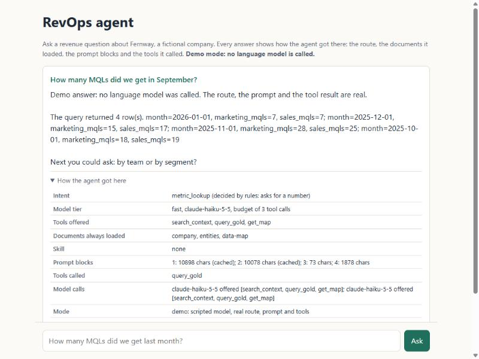
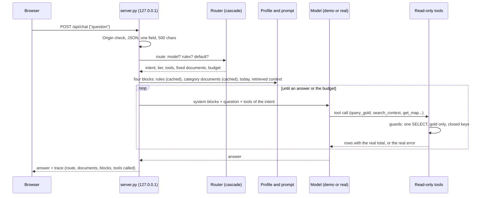

# Agent chat

A local web chat that shows the RevOps agent answering, and how it got to each answer. No key, no hosting, no external dependency.



## How to run it

```bash
python tools/setup.py                 # once, to build the local lakehouse
python apps/agent-chat/server.py      # then open http://127.0.0.1:8765
```

`--model` uses the real model instead of the demo one, only when `ANTHROPIC_API_KEY` is set. It has never been run that way.

## What happens when you ask



In demo mode, `demo_model.py` plays the model: it picks one tool the intent allows, with a fixed query for the question's topic, and writes a short answer from the real rows. Everything else is the real agent: the router, the profile, the four prompt blocks, the budget, the tool guards, the refusal of a write request and the log.

## Files

| File | Role |
|---|---|
| `server.py` | Local HTTP server: validation, Origin check, security headers, calls the agent and returns the trace |
| `demo_model.py` | Scripted stand-in for the model, with the same method as the real adapter |
| `page.html`, `app.js`, `app.css` | The page; every value is set as text, never as HTML |
| `SPEC.md` | What it shows, what it reads, what it must never do |

## What it shows of the original design

The production agent behind this design was a web chat for leaders. Its quality came from mechanisms around the model, several of them adopted after studying a data agent built by an engineering team. They are all visible on this page:

| Mechanism | Where it is here |
|---|---|
| Route first, with a cheap step and a fallback that never fails | `agent/router.py`, shown as "decided by" |
| Documents an answer always needs are loaded by id, not left to retrieval | the "Documents always loaded" row |
| Four ordered prompt blocks, the stable ones cached | the "Prompt blocks" row |
| Only the tools of the intent are offered | the "Tools offered" row |
| Guards in code, not in the prompt: one read, gold only, closed keys | `agent/tools/` |
| A request to write is refused before any model call | the fourth example question |
| No narration of the process, and two or three next cuts after a number | the answer text |

## How others build this, and how it compares

Current practice for data-analyst agents, and where this repository stands:

- **A semantic layer beats raw tables.** Practitioners report that text-to-SQL over raw schemas is unreliable and that querying certified metrics and joins helps most ([Cube](https://cube.dev/articles/ai-agents-for-data-analysis), [Xomnia](https://xomnia.com/?p=2272)). Here the agent queries gold only, and the context documents and data map give it definitions, joins and model queries.
- **Layered guardrails on every generated query**: parsing, an allow-list, limits ([DEV Community](https://dev.to/gowthampotureddi/text-to-sql-in-production-evaluation-harnesses-guardrails-semantic-layer-grounding-4o3e)). Here: `query_gold` parses the statement, refuses anything but one read on gold and caps the result.
- **Verified queries reused as examples**, with consequential questions kept under human review. Here: the model queries in the CRM and data maps, and the agent never writes.
- **Evaluate on execution, against a gold set.** Here: retrieval, router and profile evals run in CI; answer accuracy waits for a real model.
- **Start with the simplest loop; the code decides what a tool call may do** ([Anthropic: writing tools for agents](https://www.anthropic.com/engineering/writing-tools-for-agents)). Here: one loop, a budget counted in code, tool descriptions that say what they refuse.

## Limits

It has never answered with a real model, it has no sign-in (it does not need one on 127.0.0.1), and it keeps no conversation history. Hosting it for a team is the decision in ADR-0022.
