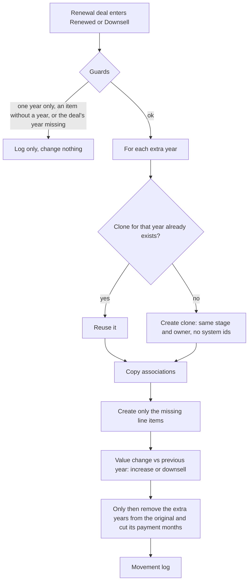

# Multi-year contract split, Spec

Status: example, not built

## Problem
To get the proposal right, sellers put the line items of every contract year on one renewal deal (for example 2027 and 2028). Nobody removes the other years afterwards. The deal's yearly value then counts two or three years, renewal metrics are inflated, provisioning sees a second deal for the same company and stops, and the contract audit reports the second year as "never recorded" instead of "the deal for the other year is missing".

## Why this process
Fixing it by hand means cloning the deal, redoing its associations and line items, cutting the payment months to one year and calculating the price change against the previous year, for every multi-year contract. The steps are mechanical and the same every time, so they belong in an automation; the business decisions (what the clone keeps, how the value change is classified) are fixed once in a rule document. Taken from a correction flow in the reference design.

## Expected gains
Projection on illustrative volumes, to be measured once it runs:

| Item | Assumption | Result |
|---|---|---|
| Manual split avoided | 15 multi-year renewals a quarter × 40 minutes | 10 hours a quarter |
| Renewal value accuracy | each deal carries one year only | renewal metrics stop counting two or three years |
| Provisioning unblocked | one deal per year, each with its own year | no stop on a second deal for the same company |

Measured by: renewal deals with line items of more than one year (should be zero), and audit items of the "never recorded" kind.

## How it works

1. The deal's line items are grouped by their contract year; the guards stop anything ambiguous.
2. For every extra year a clone is found or created, idempotently, and receives its associations and only the missing items.
3. The value change against the previous year is classified as an increase or a downsell.
4. Only after every clone is complete does the original lose the other years' items.

## Where AI enters
Nowhere: it is deterministic.

## Tokens and cost
No model call.

## Monitoring
A catalog card when built, with the deals split per week and the deals left untouched by a guard, each one listed for the owner.

## Trigger
A renewal deal entering the renewed or downsell stage, re-entered on every stage change.

## Inputs
- The deal, its line items with their contract year, its associations. In a real build these come from a CRM mirror table in gold.

## Rules
In a real build, a rule document would fix them; the decisions of the reference design were:
- The contract year comes from a field on each line item.
- Nothing changes when the items cover one year, when an item has no year, or when the deal's own year is not among the items.
- The original keeps its own year and only its items; its payment months are cut to that year.
- The contract term is not changed on either deal: it is the length of the whole contract, and other flows read it.
- A clone keeps every editable field except system and integration ids, with the same stage and owner, and a marker field so other flows can ignore it.
- The close date stays the real signing date; metrics cut by the contract year.
- The clone's expansion is blank; the value difference to the previous year goes to price increase when it rises and to downsell when it falls.
- Deal values are not written: they follow from the line items through the existing chain.

## Effects
New deals for the extra years, their associations and line items, the original's items removed and its payment months cut, and one movement-log line per change. All under a write-back authorization with a cap and a kill switch.

## Failure behavior
A missing marker field fails the run before any write. A clone that cannot be completed leaves the original untouched; the next run reuses the partial clone and finishes it. Any record left untouched by a guard is listed, never silently skipped.

## Must never
- Write to any data source without its write-back authorization and the kill switch on
- Remove items from the original before every clone is complete
- Change the contract term, or match a clone by name instead of by the original's id and the year
- Run for a deal whose years are ambiguous

## Dry run
A real build would default to a dry run that prints the planned clones and moves, as every automation here does.

## Security checklist
Standard: `docs/standards/security.md`, automation checklist. Not built, so nothing is ticked.

- [ ] Idempotent: running twice does not duplicate effects.
- [ ] Retries with backoff, and a cap.
- [ ] Respects rate limits of every API it calls.
- [ ] Failures are logged and alerted, never swallowed.
- [ ] Credentials scoped to the minimum and registered.
- [ ] Dry-run mode for anything that would write to an external system.
