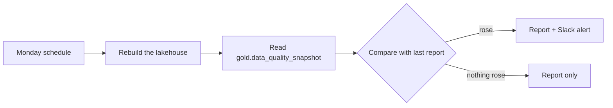

# Weekly data-quality audit, Spec

Status: built

## Problem
Data-quality issues (duplicate companies, deals without a company, subscriptions without a deal, won deals without a subscription) creep in every week. Nobody notices until a number in a meeting is wrong, and then nobody knows whether the issue is new.

## Why this process
The flags already exist in gold; what was missing is someone looking every week and comparing with the last look. A dashboard waits to be opened; a weekly report that says "this rose" goes to the people who fix it. It reports, it never fixes, so it needs no write authorization.

## Expected gains
Projection on fictional volumes, to be measured once it runs:

| Item | Assumption | Result |
|---|---|---|
| Manual weekly check avoided | 45 minutes a week of an analyst counting flags by hand | about 3 hours a month |
| Issues caught before a meeting | 2 rises a month caught a week earlier | fewer wrong numbers presented |

Measured by: weeks with a raised flag, and the time from a rise to its fix in the records.

## How it works

1. The Monday workflow rebuilds the lakehouse and runs the audit.
2. It reads the snapshot of flags, compares each with the previous report and marks what rose.
3. It writes one report per data date and, when a flag rose, one alert through the notifier.

## Where AI enters
Nowhere: it is deterministic.

## Tokens and cost
No model call. CI minutes only.

## Monitoring
Catalog card `weekly-audit`, status from `weekly-audit.yml`, expected every 8 days; the watchdog restarts it if late. The number to watch: flags that rose, week by week.

## Trigger
Every Monday morning (UTC), and on demand. Scheduled by `.github/workflows/weekly-audit.yml`.

## Inputs
One gold table, read-only: `gold.data_quality_snapshot`.

## Rules
- The audit reports every flag count next to its total and its share.
- The audit raises "attention" for a flag only when its count is higher than in the previous report. A count that is steady or falling is reported, not raised.
- The first report has nothing to compare with, so it raises nothing.
- Closed won deals without a subscription include deals won in the last two weeks; that is normal and is stated in the report, see the context document `cross-cutting-rules`.
- What each flag means and who owns the fix is in `cross-cutting-rules`. The audit does not repeat those rules.

## Effects
Writes one file, `observability/logs/audit-<as_of date>.md`, only when run with `--write`. This is the simulated alert channel. Nothing is sent to any external system and no record is changed.

## Failure behavior
If gold or the snapshot table is missing, the audit exits with an error and a message, and writes nothing. An error is never reported as "no problems".

## Must never
- Write to any data source
- Read from silver or bronze
- Delete or merge the flagged records
- Send a message to an external system

## Dry run
Dry-run is the default: the report is printed and no file is written. `--write` turns the effect on. Running twice for the same data date overwrites the same file, so effects are not duplicated.

## Security checklist
Standard: `docs/standards/security.md`, automation checklist.

- [x] Idempotent: running twice does not duplicate effects. Verified by a test that writes twice and finds one file.
- [x] Retries with backoff, and a cap. Not applicable: there is no network call, only a local read-only file.
- [x] Respects rate limits of every API it calls. Not applicable: it calls no API.
- [x] Failures are logged and alerted, never swallowed. A missing table exits with code 1 and a message; tested.
- [x] Credentials scoped to the minimum and registered. It uses none; it reads the local lakehouse, already registered as `lakehouse`.
- [x] Dry-run mode for anything that would write to an external system. Dry-run is the default, and it writes no file; tested.
