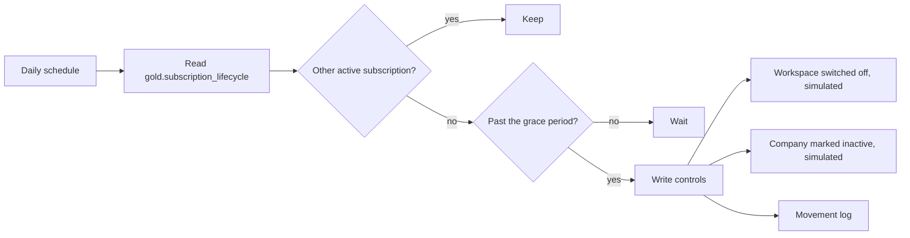

# Deactivation after churn, Spec

Status: built

## Problem
When a customer churns, someone has to remember to switch off its workspace and mark the company inactive in the CRM. When nobody remembers, former customers keep using the product for free and the CRM still counts them as customers.

## Why this process
The rule is fixed (a grace period after the subscription ends, and only if the company has no other active subscription) and the data is in billing. A daily automation applies it the same way every time, never deletes anything, and leaves a record of each change. Inspired by the reference design's deactivation of access after churn.

## Expected gains
Projection on fictional volumes, to be measured once it runs:

| Item | Assumption | Result |
|---|---|---|
| Free usage closed | 1 churn a month that kept access 30 days at $1,000 MRR | about $1,000 of usage a month no longer given away |
| Manual work | 1 churn a month × 20 minutes across two systems | small, but never forgotten |
| CRM accuracy | companies marked inactive the day after the grace period | customer counts in the CRM match billing |

Measured by: churned subscriptions still active past the grace period (should be zero).

## How it works

1. Every day it reads subscriptions that ended.
2. It keeps any company with another active subscription and waits out the grace period.
3. Past the grace period it switches off the workspace and marks the company inactive, through the write controls, and logs both.

## Where AI enters
Nowhere: it is deterministic.

## Tokens and cost
No model call.

## Monitoring
Catalog card `churn-deactivation`, status from `daily-automations.yml`. The number to watch: churned subscriptions past the grace period that are still active.

## Trigger
Daily, in the daily automations workflow. Can be run by hand with `--date`.

## Inputs
- `gold.subscription_lifecycle`: status, end date and the company's other active subscriptions.

## Rules
All in `context/rules/churn-deactivation.md`: the 7-day grace period, the other-subscription rule, switch off and never delete. Read at run time.

## Effects
With `--write` and `CHURN_DEACTIVATION_ENABLED=true`: the workspace switched off and the company marked inactive (both simulated), two lines per subscription in `observability/logs/movements-<date>.md`.

## Failure behavior
A missing lakehouse or table, or a context document that no longer states the grace period, stops the run with exit code 1 and changes nothing.

## Must never
- Write to any data source other than the workspace access and the company status, and only with the kill switch on
- Delete a workspace or any data
- Deactivate a company that has another active subscription
- Read from silver or bronze

## Dry run
The default prints each decision and writes nothing. `--write` without the kill switch is a shadow run.

## Security checklist
Standard: `docs/standards/security.md`, automation checklist.

- [x] Idempotent: running twice does not duplicate effects. Changes are keyed by subscription and company in the movement log; tested.
- [x] Retries with backoff, and a cap. The write controls cap writes at 10 per run and stop after three failures.
- [x] Respects rate limits of every API it calls. Capped per run; the calls are simulated.
- [x] Failures are logged and alerted, never swallowed. Errors exit with code 1; unapplied changes are "needs review"; tested.
- [x] Credentials scoped to the minimum and registered. Authorised as `churn-deactivation` in the write-back rules.
- [x] Dry-run mode for anything that would write to an external system. Dry run by default, shadow without the kill switch; tested.
