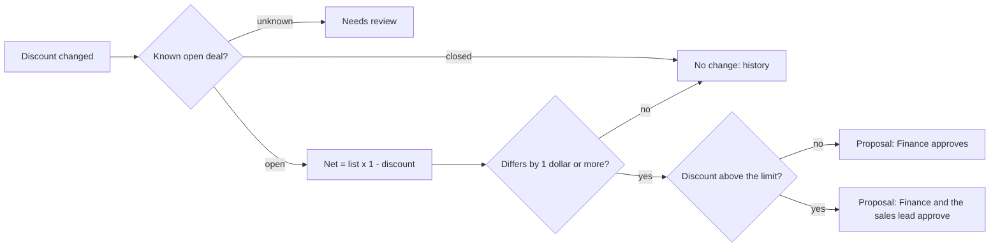

# Deal amount recalculation, Spec

Status: built

## Problem
When a seller changes a discount, the deal amount in the CRM has to be recalculated by hand. It often is not, so the pipeline value, the proposal and later the subscription disagree, and the reconciliation finds the gap weeks later.

## Why this process
The calculation is mechanical (list amount times one minus the discount), but the amount is money: a wrong automatic write is worse than a late manual one. So the automation calculates every change the moment it happens and turns it into a proposal that Finance approves item by item, with the sales lead added above the discount limit. Inspired by the reference design's net price recalculation, with the approval path its write-back rules required for sensitive fields.

## Expected gains
Projection on fictional volumes, to be measured once it runs:

| Item | Assumption | Result |
|---|---|---|
| Wrong amounts in the pipeline | 10 discount changes a month, 3 of them never recalculated by hand | 3 fewer wrong amounts a month |
| Approval time | proposals ready with the calculation and the approver named | about 5 minutes per change instead of 15 |
| Gaps found at close | amounts right before the deal is won | fewer "amount differs" items in the reconciliation |

Measured by: proposals per month, approved versus rejected, and "amount differs" items in the reconciliation.

## How it works

1. A discount change names a deal, its list amount and the discount.
2. The net amount is calculated and compared with the current one from gold.
3. A real difference on an open deal becomes a proposal with its approvers; nothing is written to the CRM.

## Where AI enters
Nowhere: it is deterministic.

## Tokens and cost
No model call.

## Monitoring
Catalog card `deal-amount`, status from its proposal files. The number to watch: proposals waiting for approval for more than two days.

## Trigger
A discount change on a deal. Simulated here by an events file.

## Inputs
- `gold.deal_amount`: the stage and current amount of every deal.
- The discount-change events.

## Rules
All in `context/rules/deal-discount.md`: the net amount formula, the 1-dollar tolerance, the 20 percent limit, open deals only, and that every change is a proposal. Read at run time.

## Effects
With `--write`: one proposals file per day in `observability/logs/amount-proposals-<date>.md`. No write to the CRM, ever.

## Failure behavior
A missing lakehouse or table, an event with an invalid amount or discount, or a context document that no longer states the tolerance or the limit stops the run with exit code 1 and proposes nothing.

## Must never
- Write the amount, or anything, to the CRM: it only proposes
- Recalculate a closed deal
- Approve a proposal on anyone's behalf
- Read from silver or bronze

## Dry run
The default prints the proposals and writes nothing. `--write` writes the proposals file.

## Security checklist
Standard: `docs/standards/security.md`, automation checklist.

- [x] Idempotent: running twice does not duplicate effects. One proposals file per day, overwritten on rerun; tested.
- [x] Retries with backoff, and a cap. Not applicable: no external call.
- [x] Respects rate limits of every API it calls. Not applicable: it calls no API.
- [x] Failures are logged and alerted, never swallowed. Invalid input exits with code 1; tested.
- [x] Credentials scoped to the minimum and registered. None: it writes no external system.
- [x] Dry-run mode for anything that would write to an external system. Dry run by default; it never writes externally.
