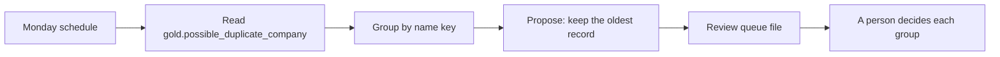

# Possible duplicate companies, Spec

Status: built

## Problem
Two company records with the same name split one account's history, owners and deals. Merging cannot be undone, so it must never be automatic. This automation turns the duplicate flag into a weekly review queue with one proposal per group, for a person to decide. It follows `docs/standards/audits.md`.

## Why this process
Merging is irreversible, so it must never be automatic; but leaving duplicates unseen splits history and ownership. The process turns the flag into a weekly queue of proposals, so a person decides group by group with the evidence in front of them.

## Expected gains
Projection on fictional volumes:

| Item | Assumption | Result |
|---|---|---|
| Search time avoided | 9 groups a week found by hand at 10 minutes each | 1.5 hours a week |
| Wrong merges avoided | a person approves each group | zero automatic merges by design |

Measured by: groups in the queue week by week; the count should fall as groups are merged.

## How it works

1. Reads the flagged records and groups them by name key.
2. Proposes keeping the oldest record of each group.
3. Writes the queue; a person approves or rejects and merges by hand in the CRM.

## Where AI enters
Nowhere: it is deterministic.

## Tokens and cost
No model call.

## Monitoring
Catalog card `duplicate-companies`, status from `weekly-audit.yml`. The number to watch: groups waiting in the queue.

## Trigger
Weekly, in the Monday audit workflow, after the lakehouse is rebuilt. Can be run by hand.

## Inputs
- `gold.possible_duplicate_company`: flagged company records with the name key they share.
- `gold.data_quality_snapshot`: the data date.

## Rules
- A group is the records that share a name key (lower case, no spaces at the ends), as `cross-cutting-rules` defines the flag.
- The proposal keeps the oldest record of the group, the likeliest to carry the history; the others are listed for review.
- Each group is decided by a person, never in bulk. An approved merge is done by hand in the CRM.
- The next run is the reconciliation: a merged group leaves the queue.

## Effects
With `--write`: one queue file per data date in `observability/logs/duplicate-companies-<date>.md`. No other effect.

## Failure behavior
A missing lakehouse or table stops the run with exit code 1 and writes nothing. A failure is never reported as "no duplicates".

## Must never
- Write to any data source, merge or delete a company record
- Read from silver or bronze
- Approve a group on a person's behalf

## Dry run
The default: the queue is printed and nothing is written. `--write` writes the queue file.

## Security checklist
Standard: `docs/standards/security.md`, automation checklist.

- [x] Idempotent: running twice does not duplicate effects. One file per data date, overwritten on rerun; tested.
- [x] Retries with backoff, and a cap. Not applicable: no network call.
- [x] Respects rate limits of every API it calls. Not applicable: it calls no API.
- [x] Failures are logged and alerted, never swallowed. A missing table exits with code 1; tested.
- [x] Credentials scoped to the minimum and registered. None; it reads the registered local lakehouse.
- [x] Dry-run mode for anything that would write to an external system. Dry run is the default; tested.
