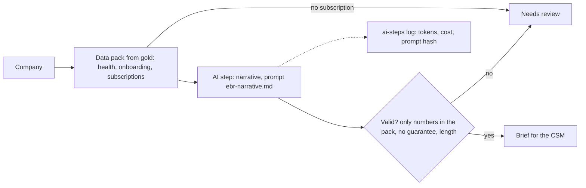

# Account review narrative, Spec

Status: built

## Problem
Before an executive business review, a customer success manager pulls the account's health, onboarding and subscription history from several screens and writes a summary. It is slow, and under time pressure numbers get rounded, mixed up or remembered wrongly in front of the customer.

## Why this process
The facts are in gold; what takes time is turning them into a readable brief. The data pack is built by code, the model only writes prose around it, and the code rejects any number or date that is not in the pack and any guarantee. Inspired by the reference design's account narrative for executive reviews.

## Expected gains
Projection on fictional volumes, to be measured once it runs:

| Item | Assumption | Result |
|---|---|---|
| Preparation time | 10 reviews a month × 30 minutes of gathering and writing | 5 hours a month |
| Wrong numbers in front of a customer | every number checked against the data pack | none by design |
| Model cost | one fast-tier call per review | well under a dollar a month |

Measured by: briefs used before reviews, and briefs sent to review by validation.

## How it works

1. The data pack is built from gold for one company.
2. The model writes the narrative and one next step.
3. The code checks every number and date, the word "guarantee" and the lengths.

## Where AI enters
One step, writing the narrative.

- Model: the fast tier, through `automations/_lib/ai_step.py`.
- Prompt: `prompts/ebr-narrative.md`, prompt sha256: `0a466714cd3c16b8ba6e9fc74aeb8f23d114edfa2a8538c6f76cf1d527744c86`.
- Output: narrative (at most 1,200 characters) and next step (at most 200), validated in code.
- Guardrails: the model sees only the data pack; any number or date not in its input is rejected; no guarantees.
- Without a key, a templated narrator plays the model, and the log says "demo".

## Tokens and cost
- Per run: about 600 input and 300 output tokens on the fast tier.
- Per month: 10 runs, about 6,000 input and 3,000 output tokens.
- Logged per run in `observability/logs/ai-steps.jsonl`; null cost until prices are set.

## Monitoring
Catalog card `ebr-narrative`. The numbers to watch: briefs rejected by validation, and briefs used.

## Trigger
A customer success manager prepares an executive review. Run by hand with company ids.

## Inputs
- `gold.account_health`: the latest health score and band.
- `gold.subscription_lifecycle`: subscriptions, their status and dates.
- `gold.onboarding_progress`: onboarding milestones.

## Rules
`context/rules/proposal-rules.md`: numbers only from the data pack, no guarantee, one next step.

## Effects
With `--write`: one briefs file per day in `observability/logs/ebr-briefs-<date>.json`. Nothing is written anywhere else.

## Failure behavior
A missing lakehouse or table stops the run with exit code 1. A company with no subscription, or a narrative that fails validation, is "needs review".

## Must never
- Write to any data source or send anything to a customer
- Use a number or date that is not in the data pack
- Promise or guarantee anything

## Dry run
The default prints the briefs and writes nothing. `--write` writes the briefs file. `--model` uses the real model, only with a key.

## Security checklist
Standard: `docs/standards/security.md`, automation checklist.

- [x] Idempotent: running twice does not duplicate effects. One briefs file per day, overwritten on rerun.
- [x] Retries with backoff, and a cap. One model call per company, capped by the run size.
- [x] Respects rate limits of every API it calls. One call per company.
- [x] Failures are logged and alerted, never swallowed. Validation failures are "needs review" and logged; tested.
- [x] Credentials scoped to the minimum and registered. The model key from the environment only (`anthropic` connector).
- [x] Dry-run mode for anything that would write to an external system. It never writes externally.
