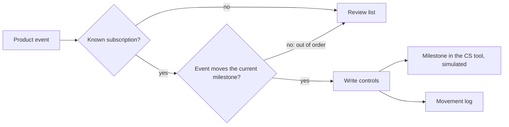

# Onboarding auto-advance, Spec

Status: built

## Problem
Onboarding managers move each customer from kickoff to configured to go-live by hand, after checking in the product that the step really happened. With dozens of customers in onboarding, moves are late or forgotten, so the onboarding board is stale and "time to go-live" cannot be trusted.

## Why this process
The evidence already exists as product events (the workspace was configured, the first job was completed), and the rule is the same for every customer. A person adds nothing to that decision; an automation applies it the moment the event arrives, records every move, and sends anything that does not fit (an event out of order, an unknown subscription) to the manager. Inspired by the reference design's stage auto-advance with its movement log.

## Expected gains
Projection on fictional volumes, to be measured once it runs:

| Item | Assumption | Result |
|---|---|---|
| Manual moves avoided | 12 new customers a month × 2 moves × 5 minutes | 2 hours a month |
| Stale board | moves recorded the day the evidence arrives instead of 3 days later on average | time to go-live accurate to the day |
| Audit trail | every move in the movement log | late moves can be chased by owner |

Measured by: days between the product event and the milestone date, and events sent to review each month.

## How it works

1. Each product event names a subscription and what happened.
2. The rule in `onboarding-milestones` says which event moves which milestone; the current milestone comes from gold.
3. A move that fits is written through the write controls and logged; anything else goes to the review list.

## Where AI enters
Nowhere: it is deterministic.

## Tokens and cost
No model call.

## Monitoring
Catalog card `onboarding-advance`, status from the movement log files. The numbers to watch: events in review, and subscriptions in kickoff or configured for more than 30 days.

## Trigger
A product event (`workspace_configured`, `first_job_completed`). Simulated here by an events file.

## Inputs
- `gold.onboarding_progress`: the current milestone of every subscription.
- The events themselves.

## Rules
All in `context/rules/onboarding-milestones.md`: the order of milestones, which event moves which, never skip, never move back. Read at run time.

## Effects
With `--write` and `ONBOARDING_ADVANCE_ENABLED=true`: the milestone in the Customer Success tool (simulated), one line per move in `observability/logs/movements-<date>.md`, and the review list in `observability/logs/onboarding-review-<date>.md`.

## Failure behavior
A missing lakehouse or table, a malformed events file, or a context document that no longer states the moves stops the run with exit code 1 and moves nothing.

## Must never
- Write to any data source other than the milestone, and only with the kill switch on
- Skip a milestone or move one back
- Read from silver or bronze
- Let the agent run it

## Dry run
The default prints each decision and writes nothing. `--write` without the kill switch is a shadow run.

## Security checklist
Standard: `docs/standards/security.md`, automation checklist.

- [x] Idempotent: running twice does not duplicate effects. Moves are keyed by event id in the movement log; tested.
- [x] Retries with backoff, and a cap. The write controls cap writes at 50 per run and stop after three failures.
- [x] Respects rate limits of every API it calls. Capped per run; the only call is the simulated write.
- [x] Failures are logged and alerted, never swallowed. Errors exit with code 1; unapplied moves are "needs review"; tested.
- [x] Credentials scoped to the minimum and registered. Authorised as `onboarding-advance` in the write-back rules.
- [x] Dry-run mode for anything that would write to an external system. Dry run by default, shadow without the kill switch; tested.
