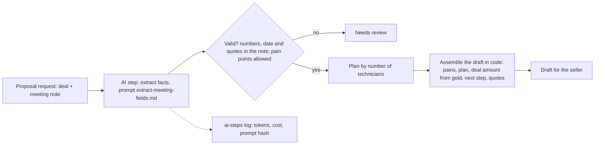

# Proposal generator, Spec

Status: built

## Problem
After a discovery call, a seller writes the proposal by hand from memory and scattered notes. It takes time, the plan recommended depends on who writes it, and details the customer said (how many technicians, the decision date) get lost or misquoted.

## Why this process
Pulling a few facts from a meeting note is a good job for a model; writing prices and promises is not. So the model only extracts facts into a fixed shape, every number, date and quote is checked against the note, and the proposal is assembled by code from those facts, the plan rule and the deal's recorded amount. The seller reviews and sends. Inspired by the reference design's proposal generator and its meeting-field extraction.

## Expected gains
Projection on fictional volumes, to be measured once it runs:

| Item | Assumption | Result |
|---|---|---|
| Seller writing time | 15 proposals a month × 25 minutes | about 6 hours a month |
| Consistent plan choice | the plan follows the technician rule, not the writer | the same customer gets the same recommendation |
| Misquoted facts | every number and quote checked against the note | none reach the draft |
| Model cost | one fast-tier call per proposal | well under a dollar a month |

Measured by: drafts used with light edits, and drafts sent to review by validation.

## How it works

1. A request names the deal and its meeting note.
2. The model extracts technicians, pain points, current tool, decision date and quotes; the code checks each.
3. The code picks the plan from `proposal-rules`, reads the deal's amount from gold, and writes the draft.

## Where AI enters
One step, extracting facts from the meeting note.

- Model: the fast tier, through `automations/_lib/ai_step.py`.
- Prompt: `prompts/extract-meeting-fields.md`, prompt sha256: `b33c9d787e809bebf7f8c2d897dd926fd746176cd700c81c416b3b38f7fd5f00`.
- Output: technicians, pain points, current tool, decision date, evidence; validated in code.
- Guardrails: the model never writes the proposal, a price or a promise; a number, date or quote not in the note sends it to review; pain points only from the allowed list.
- Without a key, a pattern-based extractor plays the model, and the log says "demo".

## Tokens and cost
- Per run: about 700 input and 150 output tokens on the fast tier.
- Per month: 15 runs, about 10,500 input and 2,250 output tokens.
- Logged per run in `observability/logs/ai-steps.jsonl`; null cost until prices are set.

## Monitoring
Catalog card `proposal-generator`. The numbers to watch: drafts sent to review, and drafts the sellers used.

## Trigger
A seller asks for a proposal after a meeting. Simulated here by a requests file and a note.

## Inputs
- `gold.deal_amount`: the deal's recorded yearly amount.
- The meeting note.

## Rules
`context/rules/proposal-rules.md`: plans by number of technicians, allowed pain points, the amount stated as recorded and never computed, drafts never sent.

## Effects
With `--write`: one drafts file per day in `observability/logs/proposals-<date>.json`. Nothing is sent and nothing is written to the CRM.

## Failure behavior
A missing note, a malformed requests file, a missing lakehouse, or a rule document that no longer states the plans stops the run with exit code 1. An extraction that fails validation is "needs review".

## Must never
- Write to any data source or send the proposal
- Let the model write a price, a discount, a saving or a promise
- Keep a fact that is not in the meeting note

## Dry run
The default prints the drafts and writes nothing. `--write` writes the drafts file. `--model` uses the real model, only with a key.

## Security checklist
Standard: `docs/standards/security.md`, automation checklist.

- [x] Idempotent: running twice does not duplicate effects. One drafts file per day, overwritten on rerun.
- [x] Retries with backoff, and a cap. One model call per request, capped by the run size.
- [x] Respects rate limits of every API it calls. One call per request.
- [x] Failures are logged and alerted, never swallowed. Validation failures are "needs review" and logged; tested.
- [x] Credentials scoped to the minimum and registered. The model key from the environment only (`anthropic` connector).
- [x] Dry-run mode for anything that would write to an external system. It never writes externally.
