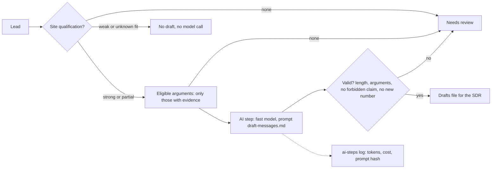

# Prospecting drafts, Spec

Status: built

## Problem
SDRs write the first message and the follow-up for every new account by hand. Good ones take long; fast ones are generic and get ignored. Messages also drift into claims nobody approved: discounts, guarantees, numbers that are not true.

## Why this process
A model writes a good first draft in seconds, but only if it is fed the right material and nothing else. The process makes the guardrails structural: only arguments whose evidence was found in the site qualification ever reach the model, a weak-fit company gets no draft and no model call, and the code rejects any draft with a price, a discount, a guarantee, a competitor, a link or a number that was not in the input. The SDR reviews and sends; nothing is sent automatically. Inspired by the reference design's personalised prospecting messages flow, whose rule was "a guardrail turned into a prompt instruction is a regression".

## Expected gains
Projection on fictional volumes, to be measured once it runs:

| Item | Assumption | Result |
|---|---|---|
| SDR writing time | 40 accounts a month × 2 messages × 8 minutes | about 10 hours a month |
| Personalisation | every draft built on evidence from the company's own site | higher reply rate expected; measured against generic messages |
| Unapproved claims | blocked in code before the SDR sees the draft | zero by design |
| Model cost | see "Tokens and cost" | well under a dollar a month at this volume |

Measured by: drafts used as written or lightly edited, reply rate against generic messages, and drafts rejected by validation.

## How it works

1. Each lead is matched to its company's site qualification.
2. Only arguments whose evidence exists are selected; nothing else reaches the model.
3. The model writes the two messages in a fixed JSON shape; the code checks every rule.
4. Valid drafts go to a file for the SDR; tokens, cost and the prompt hash are logged.

## Where AI enters
One step, writing the two messages.

- Model: the fast tier (`claude-haiku-5-5`), through the agent's adapter.
- Prompt: `prompts/draft-messages.md`, prompt sha256: `aee30edbc82b198b03fd75a3ff91df3ce4e733eb35b0018ac0a7dc524d86b310`, checked in CI by `tools/check_prompts.py`.
- Output: one JSON object with `first_touch`, `follow_up` and `arguments_used`, validated in code.
- Guardrails in code: ineligible arguments never enter the input; weak-fit leads never reach the model; forbidden claims, links and new numbers are rejected; the model never sends anything.
- Without a key, a scripted writer assembles the drafts from the arguments' own sentences, and the log says the mode was "demo".

## Tokens and cost
- Per run: about 900 input tokens and 250 output tokens on the fast tier; no call for weak-fit leads.
- Per month: 40 runs at most, about 36,000 input and 10,000 output tokens.
- Logged per run in `observability/logs/ai-steps.jsonl` with the prompt hash and no message text. The cost is null until the price table is filled.

## Monitoring
Catalog card `prospecting-drafts`, status from its drafts files. The numbers to watch: share of drafts rejected by validation, drafts used by SDRs, cost per month.

## Trigger
A new lead assigned to an SDR whose company has a site qualification. Simulated here by a leads file.

## Inputs
- The leads and the site qualification results (`site-qualification`).
- No gold table. The eligible arguments and forbidden claims come from `context/rules/prospecting.md`.

## Rules
All in `context/rules/prospecting.md`: the eligible arguments and the evidence each needs, no draft for weak fit, the forbidden claims, the length limits, and that the SDR sends. Read at run time.

## Effects
With `--write`: one drafts file per day in `observability/logs/prospecting-drafts-<date>.json`, for the SDRs. Every model run adds one line to the AI-steps log. Nothing is sent and nothing is written to the CRM.

## Failure behavior
A malformed leads or qualifications file, or a context document that no longer lists the arguments, stops the run with exit code 1. A draft that fails validation is "needs review".

## Must never
- Write to any data source or send any message: it only drafts
- Give the model an argument without evidence, or call it for a weak-fit lead
- Keep a draft with a price, a discount, a guarantee, a competitor, a link or a number not in the input

## Dry run
The default prints the drafts and writes nothing. `--write` writes the drafts file. `--model` uses the real model, only with a key.

## Security checklist
Standard: `docs/standards/security.md`, automation checklist.

- [x] Idempotent: running twice does not duplicate effects. One drafts file per day, overwritten on rerun; tested.
- [x] Retries with backoff, and a cap. One model call per eligible lead, capped by the run size.
- [x] Respects rate limits of every API it calls. One call per lead at most; none for weak fit.
- [x] Failures are logged and alerted, never swallowed. Validation failures are "needs review" and logged; tested.
- [x] Credentials scoped to the minimum and registered. The model key only from the environment (`anthropic` connector); no write authorization needed.
- [x] Dry-run mode for anything that would write to an external system. It never writes externally; dry run by default.
