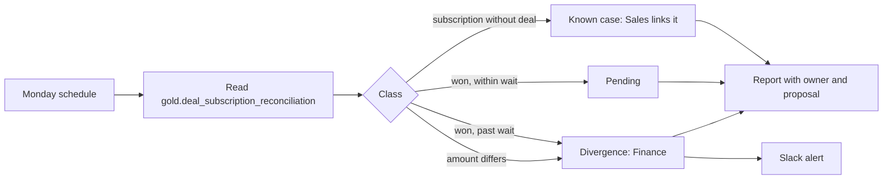

# Reconciliation of won deals and subscriptions, Spec

Status: built

## Problem
A deal won in the CRM should become a subscription in billing within two weeks, at the same value. When it does not, revenue is missing or a customer is not provisioned, and nobody notices until the month closes. This audit lists every disagreement by deal id, says who fixes it, and proposes the fix. It follows `docs/standards/audits.md`.

## Why this process
Revenue missing from billing or a customer not provisioned is found at month close, weeks late. Matching deals and subscriptions by id every week turns that into a short list with an owner and a proposal for each item, while the problem is still small.

## Expected gains
Projection on fictional volumes:

| Item | Assumption | Result |
|---|---|---|
| Revenue found earlier | 1 won deal a month without a subscription at $1,500 MRR, found 3 weeks earlier | about $1,000 of MRR a month not left uncollected |
| Analyst time | 2 hours a month matching deals and subscriptions by hand | 2 hours a month |

Measured by: divergences open week by week, and days from a divergence to its fix.

## How it works

1. Reads every won deal and subscription matched by deal id.
2. Puts each record in one class, with its owner and a proposal.
3. Writes the report and alerts on divergences; nothing is corrected.

## Where AI enters
Nowhere: it is deterministic.

## Tokens and cost
No model call.

## Monitoring
Catalog card `reconciliation`, status from `weekly-audit.yml`. The number to watch: divergences open.

## Trigger
Weekly, in the Monday audit workflow, after the lakehouse is rebuilt. Can be run by hand.

## Inputs
- `gold.deal_subscription_reconciliation`: every closed won deal and every subscription, matched on the deal id the subscription carries.
- `gold.data_quality_snapshot`: the data date.

## Rules
- Sources: the CRM (deals) and billing (subscriptions); billing is the source of truth for revenue (`cross-cutting-rules`).
- Join key: the deal id the subscription carries. Never a company name.
- Classes, in order: subscription without deal (known case, owner Sales); won without subscription within the wait (pending, owner Finance); won without subscription past the wait (divergence, owner Finance with Customer Success); amount differs beyond the tolerance (divergence, owner Finance).
- The tolerance (1 dollar a month) is read from `cross-cutting-rules` and the wait (two weeks) from `closed-won-provisioning`, at run time.
- The report states the scope, the join coverage, the tolerance and the wait at the top.

## Effects
With `--write`: one report per data date in `observability/logs/reconciliation-<date>.md`, and one Slack alert listing up to five divergences when there is at least one, through `observability/notify.py` and its kill switch. No other effect.

## Failure behavior
A missing lakehouse or table, or context documents that no longer state the tolerance or the wait, stops the run with exit code 1 and writes nothing. A failure is never reported as "all reconciled".

## Must never
- Write to any data source: it proposes, owners correct
- Match on a name or a fuzzy similarity
- Read from silver or bronze
- Correct records in bulk, or at all

## Dry run
The default: the report is printed and nothing is written or sent. `--write` writes the report file and sends the alert; the alert also needs `SLACK_ALERTS_ENABLED=true`.

## Security checklist
Standard: `docs/standards/security.md`, automation checklist.

- [x] Idempotent: running twice does not duplicate effects. One file per data date, overwritten on rerun; tested.
- [x] Retries with backoff, and a cap. Not applicable to the read; the alert goes through the write controls, with their cap.
- [x] Respects rate limits of every API it calls. Not applicable: the only outbound call is the optional alert, capped per run.
- [x] Failures are logged and alerted, never swallowed. A missing table exits with code 1; tested.
- [x] Credentials scoped to the minimum and registered. None besides the registered `slack` connector for the alert.
- [x] Dry-run mode for anything that would write to an external system. Dry run is the default; tested.
