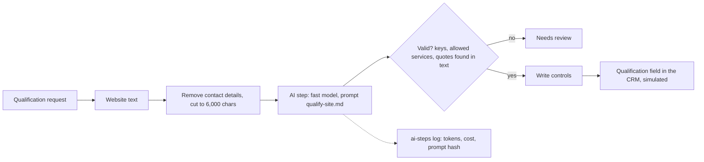

# Site qualification, Spec

Status: built

## Problem
Before calling a company, an SDR opens its website to see whether it has field technicians, what services it offers and what to talk about. It takes several minutes per company, the notes are uneven, and much of it never reaches the CRM, so the next person starts again.

## Why this process
Reading a website and pulling out a few facts is where a model is genuinely good and a rule is not. But a model can also invent, so the process puts code around it: contact details are removed before the model sees the text, the answer must be a fixed JSON shape, services must come from an allowed list, every quote must appear word for word in the site, and only a validated result is written. Inspired by the reference design's website qualification flow, which fed its personalised messages.

## Expected gains
Projection on fictional volumes, to be measured once it runs:

| Item | Assumption | Result |
|---|---|---|
| SDR research time | 40 companies a month × 6 minutes of reading | 4 hours a month |
| Consistent notes | the same five fields for every company, in the CRM | the next rep starts from the summary, not from zero |
| Better targeting | weak-fit companies flagged before a call | fewer calls to companies outside the ICP |
| Model cost | see "Tokens and cost" | well under a dollar a month at this volume |

Measured by: qualifications written, share sent to review, and the SDRs' rating of the summaries.

## How it works

1. A request names a company; the website text is read (from a file here).
2. Contact details are removed and the text is cut, before the model sees it.
3. The model answers in a fixed JSON shape; the code validates every field and every quote.
4. A valid result is written through the write controls; tokens, cost and the prompt hash are logged for every run.

## Where AI enters
One step, the qualification itself.

- Model: the fast tier (`claude-haiku-5-5`), through the agent's adapter.
- Prompt: `prompts/qualify-site.md`, prompt sha256: `336419bc050e79d054351cc724e7a08946f500dd0369c408be9727468291c093`. `tools/check_prompts.py` fails CI if the prompt changes and this line does not, so every evaluation is tied to a known prompt.
- Output: one JSON object with `fit`, `technicians_mentioned`, `services`, `evidence` and `summary`, validated in code.
- Guardrails in code: contact details never reach the model; services only from the allowed list in `prospecting`; a quote that is not in the text sends the result to review; the model never writes anything itself.
- Without a key, a scripted qualifier plays the model (keyword evidence), and the log says the mode was "demo".

## Tokens and cost
- Per run: about 1,800 input tokens (prompt and up to 6,000 characters of text) and 200 output tokens, on the fast tier.
- Per month: 40 runs, about 72,000 input and 8,000 output tokens.
- Logged per run in `observability/logs/ai-steps.jsonl`: automation, mode, model, prompt hash, tokens including cache, cost and latency, with no website text. The cost is null until the price table in `agent/tools/README.md` is filled; it is never logged as zero for a real call.

## Monitoring
Catalog card `site-qualification`, status from its result files. The numbers to watch: share of runs that fail validation (a rise means the prompt or the sites changed), cost per month, and qualifications waiting for a rep.

## Trigger
A qualification request for a company (in production, a field set by the SDR; the field the automation writes when it finishes is a different one, so an unfinished run can be found). Simulated here by a requests file.

## Inputs
- The request and the company's website text (a file per company here).
- No gold table: the website is the source. The allowed services and the guardrails come from `context/rules/prospecting.md`.

## Rules
All in `context/rules/prospecting.md`: the allowed service labels, quotes word for word, contact details removed. Read at run time.

## Effects
With `--write` and `SITE_QUALIFICATION_ENABLED=true`: the qualification field of the company in the CRM (simulated as `observability/logs/site-qualification-<date>.json`, keyed by request). Every run, written or not, adds one line to the AI-steps log.

## Failure behavior
A missing website file, a malformed requests file or a context document that no longer lists the services stops the run with exit code 1 and writes nothing. An output that fails validation is "needs review", never written.

## Must never
- Write to any data source other than the qualification field, and only with a validated output and the kill switch on
- Send contact details or personal data to the model
- Write a quote that is not in the website text, or a service off the allowed list
- Let the model write anything directly

## Dry run
The default runs the qualification and prints it, and writes nothing to the CRM. `--write` without the kill switch is a shadow run. `--model` uses the real model, only with a key.

## Security checklist
Standard: `docs/standards/security.md`, automation checklist.

- [x] Idempotent: running twice does not duplicate effects. Results are keyed by request id; tested.
- [x] Retries with backoff, and a cap. The write controls cap writes at 50 per run and stop after three failures.
- [x] Respects rate limits of every API it calls. One model call per company, capped by the run size.
- [x] Failures are logged and alerted, never swallowed. Validation failures are "needs review" and logged with the reason; tested.
- [x] Credentials scoped to the minimum and registered. The model key only from the environment (`anthropic` connector); the write authorised as `site-qualification`.
- [x] Dry-run mode for anything that would write to an external system. Dry run by default, shadow without the kill switch; tested.
