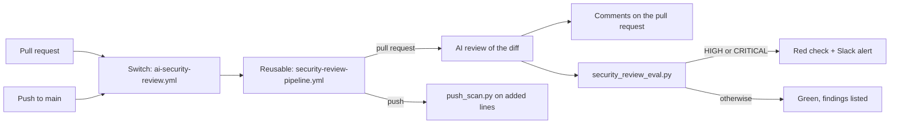

# Security review pipeline

An automatic first sieve on every change: an AI review reads only the diff of each pull request, comments where people already look, turns the check red on a serious finding and says so in Slack; a cheap scan covers a push to main that skipped review. Taken from the reference design, where one reusable pipeline served every app.

## What it does

1. On a **pull request**, the AI review reads the diff and looks for real, exploitable issues introduced by it.
2. It **comments on the pull request** with the file, the line, what is wrong and what to do.
3. `tools/security_review_eval.py` reads its findings: any **HIGH or CRITICAL** turns the check red and sends one Slack alert through the shared notifier. MEDIUM and LOW stay as comments.
4. On a **push to main**, `tools/push_scan.py` scans only the added lines for credential shapes and fails if it finds one, printing the kind, never the value.

## What it is not

- Not a replacement for authorisation on the server, row-level security, a human review of sensitive changes, or keeping `.env` out of git. It is the first sieve.
- Not a dependency audit and not a scan of the whole repository: only what changed.
- Not a merge lock by itself: a red check blocks the merge only when it is a required check on a protected branch.
- If the repository already has an equivalent AI reviewer, do not stack two: choose one.

## Design

| Piece | File | Role |
|---|---|---|
| The pipeline | `.github/workflows/security-review-pipeline.yml` | reusable workflow holding all the logic |
| The switch | `.github/workflows/ai-security-review.yml` | calls the pipeline; on only when `AI_SECURITY_REVIEW_ENABLED` is true |
| The evaluator | `tools/security_review_eval.py` | red on HIGH or CRITICAL, summary, Slack alert |
| The push scan | `tools/push_scan.py` | credential shapes in the added lines of a push |

Another repository reuses it with the same short switch file pointing at this pipeline; no logic is copied.

## What the review looks for

Only real, exploitable issues introduced by the diff, not style or old problems: injection (SQL, command, XSS); authentication or authorisation bypass, IDOR included; hard-coded secrets; insecure deserialisation; SSRF; path traversal; weak cryptography or sensitive data exposed.

## Secrets

`ANTHROPIC_API_KEY` and `SLACK_WEBHOOK_URL` are repository secrets, passed explicitly to the pipeline. The runner masks them in logs. Nothing is written to git, to a log or to a chat.

## Ready when

- [ ] The review action is pinned to a full commit SHA.
- [ ] `ANTHROPIC_API_KEY` exists as a repository secret and `AI_SECURITY_REVIEW_ENABLED` is true.
- [ ] A test pull request runs the review: no finding gives a green check.
- [ ] A test commit with an obviously fake token gives a comment, a red check and a Slack alert, and is then reverted.
- [ ] The check is required on `main` if it should block merges.

Today none of these is done: the pipeline is in place and switched off.
